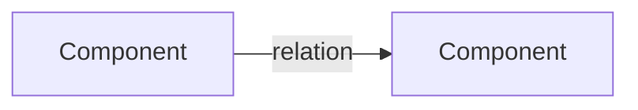

# XAX Documentation Style Guide

This guide sets how XAX Markdown documents are formatted so that people and AI agents can find, read and cite them.
It governs form only. Meaning, authority and ownership are set elsewhere and this guide never overrides them:
[`XAX_SPEC.md` §1](../XAX_SPEC.md#1-normative-language-and-precedence) (precedence),
[`AGENTS.md`](../AGENTS.md) "Documents and status" (ownership, generated blocks, historical records) and the
[documentation index](README.md) (document classes). Human readability has no normative weight
(`XAX_SPEC.md` §1), so every rule below yields to technical meaning.

## Contents

- [1. Scope and authority](#1-scope-and-authority)
- [2. Preservation rules](#2-preservation-rules)
- [3. General formatting](#3-general-formatting)
- [4. Anti-patterns](#4-anti-patterns)
- [5. Templates](#5-templates)
- [6. Validation](#6-validation)

## 1. Scope and authority

- The guide applies to new documents and to text a change already touches. It does not authorize reformatting
  existing documents; formatting-only edits to normative or historical text need their own reviewed reason.
- Where an existing document has a settled local convention (for example the `## ADR-<n> — <title>` field table in
  `XAX_DECISIONS.md`), follow that document. This guide describes the common baseline.
- Templates in [section 5](#5-templates) are guidelines. Omit any section that has nothing true to say; never fill a
  section with "N/A" or invented content to complete a shape.
- This guide is a formatting reference, not evidence. It records no capability, level or result.

## 2. Preservation rules

Formatting MUST NOT change technical meaning. When a formatting choice and a fact conflict, keep the fact.

- **Normative terms.** `MUST`, `MUST NOT`, `SHOULD`, `SHOULD NOT` and `MAY` are normative only in uppercase
  ([`XAX_SPEC.md` §1](../XAX_SPEC.md#1-normative-language-and-precedence)). Do not change their case, split a
  requirement from its qualification, or move an exception away from the rule it limits.
- **Authority and precedence.** Do not reorder, merge or restate the document classes of the index. A document states
  its class (normative, decision, evidence, roadmap, proposal, audit) by its place in the index, not by its style.
- **Identifiers.** ADR (`ADR-<n>`), OI (`OI-<n>`), issue and pull request numbers, milestone names (`M1`–`M14`),
  step names (`S0`–`S15`), level names (`B0`–`B6`, `R0`–`R6`) and conformance IDs are never renumbered, reused or
  respelled. A new record takes the next unused number. Numbers the originals skip stay skipped.
- **Sections and anchors.** Do not renumber or rename a numbered section or any heading that other files link to.
  Before renaming, run `grep -rn '<old-anchor>'` over the repository, and prefer adding a section to renaming one.
- **Definitions and qualifications.** Keep each definition, scope limit, exception and "only if" with the sentence it
  qualifies. Do not turn a qualified claim into a bare one when shortening or converting prose to a list or table.
- **Evidence and chronology.** Dated sections, evidence records and benchmark results are historical. Never rewrite
  or reorder them; add a new dated section and point the superseded one at it (`AGENTS.md`). Keep measurements with
  their units, counts, sample sets and evidence labels (`EXECUTED`, `MEASURED`, `NOT RUN`, `BLOCKED`); keep emulator,
  Wine and qemu runs labelled as such.
- **Generated content.** Never edit text between `<!-- xax-status:… -->` and `<!-- /xax-status:… -->` markers, or move
  or remove a marker. The generator owns the block (`sh compiler/bootstrap/status-tool/status.sh write`, then
  `compiler/tests/test_status_docs.py`). Style never applies inside a block.
- **Latest-handoff convention.** The last `## ` section of [`XAX_HANDOFF.md`](../XAX_HANDOFF.md) is the current
  handoff. Append new sections at the end; never insert a section after the current one's position and never leave
  an older section last.
- **Ownership.** One authoritative owner per fact; link to it, do not copy it. Do not move a fact to a different
  document for formatting reasons. Shared ecosystem rules live in `AGENTS.md`; do not restate or vary them.
- **Language rule.** Documentation does not introduce non-XAX code as logic. Fenced examples are illustrations, and
  protocol examples are tooling views, never authoritative XAX source (`AGENTS.md`).

## 3. General formatting

### 3.1 Titles, headings and contents

- One `#` title per file, first line, naming the document plainly.
- Then `##`, `###`, `####`; never skip a level and never go deeper than `####`. If a fifth level seems needed, split
  the section.
- Headings are sentence-style noun phrases without trailing punctuation. Do not use bold text as a heading.
- Normative and long reference documents (more than about 150 lines or five `##` sections) carry a `## Contents`
  list directly after the opening paragraph, linking each `##` section and, where useful, `###` subsections.
  Short READMEs and records omit it.
- Open with a paragraph stating purpose and scope. Say what the document is not when readers commonly confuse it.
- Number sections (`## 4. Name`, `### 4.2 Name`) only where the document is cited by number (specifications,
  stage documents, conformance, benchmarks, roadmap). Use `Part I — …` for top-level parts as those documents do.
  Number manually, in order, once; renumber never (see [section 2](#2-preservation-rules)).
- Use the em dash form `## ADR-<n> — Title` and `## OI-<n> — Title` for identifier headings, as the existing
  registers do.

### 3.2 Paragraphs and line length

- One idea per paragraph, usually two to five sentences. A paragraph that lists items becomes a list.
- Wrap source lines at about 120 columns, as existing documents do. Wrapping is invisible when rendered, so do not
  hard-break inside a sentence with trailing spaces or `<br>`.
- Single spaces after punctuation. No trailing whitespace. One blank line between blocks. File ends with one newline.
- Use plain ASCII punctuation in code and identifiers. In prose, the em dash (`—`) and en dash in ranges
  (`M1–M14`, `B0–B6`) follow existing practice; do not mix them with `--` inside one document.
- Write in the active voice and present tense. Specify, do not narrate a session.

### 3.3 Lists

- Use `-` for unordered lists, never `*` or `+`. Use `1.` numbering for ordered lists, written out in sequence
  (`1.`, `2.`, `3.`) so the source reads correctly.
- Ordered lists mean sequence or ranking; unordered lists mean a set. Do not use numbers merely to count.
- Indent nested items and continuation lines by two spaces for `-` and three for `1.`. Nest at most two levels; a
  third level means the content wants a table or its own subsection.
- Keep items parallel in grammar and similar in length. End full sentences with a period; fragments without one,
  consistently within a list.
- Put one blank line before and after a list. Do not put a list in a table cell.
- A list of status or completion items uses task lists:

  ```markdown
  - [x] The criterion is met and its evidence is cited.
  - [ ] The criterion is not met yet.
  ```

  Tick a box only where evidence is recorded; an unticked box is not a failure, it is open work.

### 3.4 Tables

- Use a table for records with the same fields (comparisons, field/value records, indexes). Use a list for
  sequences and prose for reasoning.
- Header row required; the separator row uses `---` (compact `|---|---|` as in the index, or padded form, consistent
  within a document). Escape a literal pipe in a cell as `\|`.
- Keep cells short: a phrase or one sentence. A cell that needs two sentences or a list belongs in prose under a
  heading, with the table pointing to it.
- Align numeric columns right with `---:`; align text left (the default). Use one numeric format per column
  (same unit, same decimal places) and put the unit in the header, not in each cell. Group thousands with a comma only
  where the surrounding document already does (`31,851,585`).
- First column identifies the row (ID, name, case). Do not leave empty cells; write `—` where nothing applies.
- Never encode meaning in cell colour, emoji or bold alone.

### 3.5 Inline technical text

Use backticks for every literal an agent might copy:

- file and directory paths, commands and flags (`compiler/AGENTS.md`, `xaxc verify`, `--check`);
- identifiers, operation names, field names, environment variables (`XAX_REQUIRE_NATIVE=1`, `wall_seconds_samples`);
- hashes and CIDs (`8d7745ab…` when shortened; give the full value once where it is authoritative);
- literal values and evidence labels (`EXECUTED`, `OPEN`, `CLOSED`).

Write product and concept names in plain text (XAX, BBC, XAX-MCP). Italics for a first-use term or a title;
bold only for a defined term at its definition or a field label (`**Status:** OPEN`), not for emphasis in running
text. Do not nest bold in backticks.

### 3.6 Links, paths and cross-references

- Link repository files with relative paths from the current file, in a backticked label when the label is a path:
  ``[`XAX_SPEC.md`](../XAX_SPEC.md)``. Never use absolute URLs or machine paths for files in this repository
  (`AGENTS.md`, "No hardcoding").
- Link to a section with its anchor and name it: ``[`XAX_SPEC.md` §1](../XAX_SPEC.md#1-normative-language-and-precedence)``.
  Anchors are the lowercase heading with spaces as `-` and punctuation removed; verify them after writing.
- Cite a record by identifier on first use per section (`ADR-207`, `OI-33`), linked when the target file is not the
  current one. Use `§N` for a section of the same or a named document; do not write "above" or "below" for
  anything a reader might reach by a link.
- Repository-relative paths in running text without a link are acceptable for code and data paths (`compiler/tests/`);
  link documents.
- External links use the full `https://` URL, with descriptive text; never "click here". Pull requests and issues
  are linked as `[owner/repo#123](https://github.com/owner/repo/pull/123)`.

### 3.7 Code blocks

- Fence with triple backticks and always a language identifier: `text` for output and diagnostics, `json`, `markdown`,
  `mermaid`, `powershell`, `sh`, `diff`. Use `text` when no language fits; never an empty fence.
- Use four backticks around a block that itself contains triple-backtick fences, as the templates below do.
- Commands in their own fence, one command or one pipeline per block, without a `$` prompt and without interleaved
  output. Show output in a separate `text` block.
- Code blocks show code, data, commands, output and diagrams only. Prose, lists and notes are not placed in fences.
- Mark an example as illustration, and do not present a textual rendering of an XAX program as source. Protocol
  examples and diagnostics are tooling views ([`09_AI_PROTOCOL.md`](09_AI_PROTOCOL.md)).
- Keep blocks short enough to read without scrolling; cite a file for the long form.

### 3.8 Mathematical notation

- Prefer plain text and backticks for small expressions (`2^n`, `a * b`). Use GitHub math (`$…$` inline, `$$…$$`
  display) only for formulas that need layout.
- Define every symbol on first use, give units, and state ranges and rounding. A formula in a normative document
  needs its definition in prose or a table beside it; the formula is not the only statement.
- Do not use math notation for bit layouts or byte encodings; use a table or a `text` block (see
  [schema template](#58-schema-and-binary-encoding-definitions)).

### 3.9 Diagrams

- Prefer Mermaid in a `mermaid` fence for architecture, dependency and workflow diagrams. Diagrams are
  illustrations: the text beside them states the same facts, and a document stays correct if the diagram does not render.
- Keep a diagram to about 15 nodes; split larger ones. Label edges with the relation. Use `flowchart TD` or `LR`,
  `sequenceDiagram` or `stateDiagram-v2`.

  ```mermaid
  flowchart LR
    Graph[Semantic graph] --> Verify[Verifier] --> Codegen[Backend] --> Artifact[Platform artifact]
  ```

- Do not use a diagram for ownership or authority claims that belong in a table or list.

### 3.10 Alerts and notes

- Use GitHub alerts sparingly, one per section at most, as `XAX_OPEN_ISSUES.md` does:

  ```markdown
  > [!IMPORTANT]
  > Only issues requiring implementation, target, ecosystem, or benchmark evidence are listed here.
  ```

- `[!NOTE]` for context, `[!IMPORTANT]` for a constraint a reader must not miss, `[!WARNING]` for a hazard that
  causes data loss, wrong results or a rejected claim. Do not use `[!TIP]` or `[!CAUTION]` for decoration.
- An alert restates nothing normative that is not also in the body text. A normative requirement lives in
  ordinary text, never only in an alert.
- Collapse long historical material with `<details>` and `<summary>` (for example the "Historical Record" of an OI),
  never to hide a requirement or a current status.

### 3.11 Dates, separators and emphasis

- Dates are ISO 8601, `YYYY-MM-DD` (`2026-11-24`); timestamps `YYYY-MM-DDThh:mm:ssZ`. Never `11/24/26` or month names
  in headings that are sorted or grepped.
- A dated section heading carries the date after an em dash, ` — 2026-11-24`, as the handoff does; a trailing
  parenthetical such as `(ADR-367)` may follow it.
- Do not use `---` horizontal rules to separate sections (headings do that). `---` appears only for YAML front matter
  or table separators.
- No decorative emoji, ASCII art or banner lines. Status words are text (`OPEN`, `CLOSED`, `NOT RUN`).

## 4. Anti-patterns

| Avoid | Do instead |
|---|---|
| A paragraph longer than about eight sentences or a screen | Split by idea; add a heading or a list |
| "A, B, C and D" carrying parallel items in a sentence | A list, one item per line |
| A table cell with several sentences or a list | A short cell that links to prose under a heading |
| A code fence holding ordinary prose or a note | Normal paragraph or alert |
| Lists nested three or more levels | A table, or a subsection per branch |
| `**Heading-like bold line**` in place of a heading | A real heading at the correct level |
| Emoji, banners and decorative bold | Plain words; a `[!NOTE]` alert if it needs attention |
| Many one-sentence paragraphs in a row | Merge related sentences; list them if parallel |
| The same fact written in two documents | One owner, and a link from the other |
| "see above", "as before", "the following" for distant content | A named link or anchor |
| Reformatting a historical record or generated block | Leave it; append a new dated section |
| Renaming or renumbering a heading that is linked | Add a new heading; keep the old anchor |

## 5. Templates

Each template shows a useful shape, not a schema. Keep the sections that carry facts for the document at hand, drop
the rest, and keep names the existing documents already use. Placeholders are in `<angle brackets>`. Links in the
templates are placeholders; real documents link to existing files.

### 5.1 Architectural Decision Records

Owner: [`XAX_DECISIONS.md`](../XAX_DECISIONS.md). A new ADR takes the next unused number, never reuses one, and is
superseded only by a later ADR (never edited in place beyond a status pointer).

````markdown
## ADR-<n> — <Decision stated as a noun phrase>

| Field | Record |
|---|---|
| Status | <Accepted / Proposed, with date, where the ADR records one.> |
| Decision | <What is adopted, in one or two sentences.> |
| Rationale | <Why; the problem and the constraint it answers.> |
| Alternatives rejected | <Each alternative and the reason in a phrase.> |
| Runtime cost expectation | <None, or the measurable cost and where it is bounded.> |
| Falsification condition | <The evidence that would reopen this decision.> |
| Supersedes / superseded by | <ADR-<m>, if any.> |
| Evidence | <`OI-<n>` or test/benchmark records; label `EXECUTED` / `MEASURED` / `NOT RUN`.> |
| Limits | <What the decision does not cover.> |
````

Add the new ADR to the Contents list of `XAX_DECISIONS.md` in the same change. Keep long derivations in prose
under the table, not in a cell.

### 5.2 Open issue records

Owner: [`XAX_OPEN_ISSUES.md`](../XAX_OPEN_ISSUES.md). The newest status line is the current state; older status
lines move into the collapsed Historical Record, never deleted.

````markdown
## OI-<n> — <Question as a noun phrase>

**Status:** OPEN (<YYYY-MM-DD>)

### Summary

<The question in two or three sentences.>

### Fixed Constraints

- <A constraint the answer must keep, with its ADR or specification section.>

### Evidence and Measurements

| Case | Result | Label |
|---|---:|---|
| <case id> | <value> <unit in header> | `MEASURED` |

- <Artifact path and the command that reproduces it.>

### Decision

<The adopted resolution once decided; otherwise "Not decided.">

### Closure Criteria

- [ ] <Criterion, ticked only where recorded evidence states it is met.>

### References

- [`ADR-<n>`](XAX_DECISIONS.md) · <issue or pull request>

<details>
<summary>Historical Record</summary>

<Dated entries, oldest first. Do not rewrite them.>

</details>
````

Add the row to the Issue Index. Use `CLOSED (<date>)` with a scope limit beside it where the closure is partial.

### 5.3 Compiler handoff records

Owner: [`XAX_HANDOFF.md`](../XAX_HANDOFF.md). Append at the end of the file; the last `## ` section is the current
handoff, and each one supersedes the "Next" of the one before.

````markdown
## <Title of the work> — <YYYY-MM-DD>

`main` = <merge commit>. <State: command result, for example the rotation state.> Supersedes the "Next" of
"<previous section title>".

- **What landed:**
  - #<n> (`ADR-<n>`, `OI-<n>`): <one line.>
- **What ran** (<EXECUTED / MEASURED / NOT RUN / BLOCKED>, with environment):
  - <Command or suite, counts, duration; exceptions with their causes.>
- **What is open:** <OI numbers and one line each.>
- **Next:**
  1. <Concrete first action with the file or command.>
````

Do not paste copies of generated blocks or ADR text; link to them. Report only what ran.

### 5.4 Current compiler state and historical milestones

Owner: [`XAX_STATE.md`](../XAX_STATE.md). The `Current status` section holds generated blocks (do not edit them);
milestone and dated sections are historical records.

````markdown
## <Topic> — <YYYY-MM-DD>

**Status:** <Established / partial / not established>. **Scope:** <target, profile, milestone>.

| Item | State | Evidence |
|---|---|---|
| <capability> | <level or result> | <record or test path>; `EXECUTED` |

- <What this section supersedes, by name, if anything.>
- <Known gap, and the OI that tracks it.>
````

State levels only through the generated blocks or a link to their sources, never by hand.

### 5.5 Benchmark specifications and measured results

Owners: [`XAX_BENCHMARKS.md`](../XAX_BENCHMARKS.md) (Part I specification, Part II results) and
`compiler/benchmarks/`. A changed case procedure creates a new case version. Raw samples are the evidence.

````markdown
### <Case id> (version <n>)

**Contract:** <semantic requirement>. **Oracle:** <reference result>. **Targets:** <exact target packages>.

| Arm | Build policy | n | Median (s) | Min (s) | Max (s) |
|---|---|---:|---:|---:|---:|
| <XAX / baseline> | <flags> | <count> | <value> | <value> | <value> |

- Raw `wall_seconds_samples`: `compiler/benchmarks/<file>.json`.
- Environment: <host, OS, CPU, load; emulator or Wine runs labelled as such>.
- Label: `MEASURED`. Exclusions: <what and why>.
````

Report measurements with units and counts exactly as recorded; add new results as new dated entries.

### 5.6 Implementation roadmap milestones

Owner: [`XAX_IMPLEMENTATION_ROADMAP.md`](../XAX_IMPLEMENTATION_ROADMAP.md). A roadmap is planned order, not evidence.

````markdown
### M<n> — <Milestone name>

#### Entry criteria

- <Condition that must hold before work starts.>

#### Required capability

- <Capability delivered.>

#### Exit criteria

- [ ] <Observable result and the evidence that shows it.>

#### Dependencies

<milestones or none>.

#### Benchmarks now valid

<what can be measured; what claims remain excluded>.
````

### 5.7 Normative specifications

Owners: [`XAX_SPEC.md`](../XAX_SPEC.md) and the `docs/NN_*.md` stage documents. Highest preservation standard:
precedence is `XAX_SPEC.md` §1; change wording only through a reviewed specification change.

````markdown
# <Document title>

<Purpose and scope paragraph. Name the specification section this document is subordinate to.>

## Contents

- [1. Purpose and scope](#1-purpose-and-scope)
- [2. Normative definitions](#2-normative-definitions)

## 1. Purpose and scope

<What is defined and what is excluded.>

## 2. Normative definitions

| Term | Definition |
|---|---|
| <term> | <definition, with its qualification kept> |

## 3. <Rule group>

### 3.1 <Rule>

An implementation MUST <required behavior>. It MUST NOT <forbidden behavior>.

- **Rejection:** <diagnostic or code, where the rule has one.>
- **Rationale:** <ADR-<n>, non-normative.>
````

Requirements use uppercase keywords; rationale and examples are labelled non-normative.

### 5.8 Schema and binary encoding definitions

Owners: [`08_SERIALIZATION_IDENTITY.md`](08_SERIALIZATION_IDENTITY.md) and
[`XAX_PROTOTYPE_SCHEMA_V1.md`](../XAX_PROTOTYPE_SCHEMA_V1.md). Byte-exact facts are never reflowed or rounded.

````markdown
### <Object kind> (kind <number>)

| Offset | Size (bytes) | Field | Type | Notes |
|---:|---:|---|---|---|
| 0 | 4 | `<field>` | `u32` little-endian | <constraint> |

```text
Object {
  kind        u8
  payload_len uleb128
  payload     bytes[payload_len]
}
```

- **Canonical form:** <the one valid encoding and what is rejected.>
- **Identity:** <hash suite and what is hashed.>
- **Vectors:** <positive and negative fixture paths.>
````

Give byte order, integer widths and padding explicitly; show hexadecimal as `0x…`.

### 5.9 Conformance requirements and test vectors

Owners: [`XAX_CONFORMANCE.md`](../XAX_CONFORMANCE.md) and [`16_CONFORMANCE_EXAMPLES.md`](16_CONFORMANCE_EXAMPLES.md).

````markdown
### <n>.<m> <Requirement area>

An implementation claiming <level or profile> MUST <behavior>.

| Vector | Input | Expected | Kind |
|---|---|---|---|
| <id> | <input or fixture path> | <result or diagnostic code> | positive / negative |

- **Required evidence:** <test names; `EXECUTED` with `XAX_REQUIRE_NATIVE=1` where native execution is claimed>.
- **Not satisfied by:** <skipped tests, compilation alone, emulator runs, as applicable>.
````

### 5.10 Architecture and design documents

Owners vary: the architecture document is `REFERENCE`, proposals under [`proposals/`](proposals/) are not normative
until an ADR adopts them.

````markdown
# <Title>

**Status:** <Proposal / Reference>. **Owner of the decision:** <ADR or OI, once adopted>.

<Problem and goals in a short paragraph.>

## Context and constraints

- <Constraint with its source.>

## Design

<Prose first.>



## Alternatives considered

| Alternative | Rejected because |
|---|---|
| <option> | <reason> |

## Verification

- <How the design will be shown to work; the evidence that would falsify it.>
````

### 5.11 Protocol and operation definitions

Owner: [`09_AI_PROTOCOL.md`](09_AI_PROTOCOL.md). Examples are tooling views, never XAX source.

````markdown
### <Operation name>

<One sentence on what the operation does and which state it reads or changes.>

| Part | Definition |
|---|---|
| Request | <fields with types> |
| Result | <fields with types> |
| Rejections | <diagnostic codes and the repair neighborhood returned> |
| Effects | <what is committed, and when> |

```text
<Example request / result as a diagnostic tooling view>
```

An implementation MUST <ordering or atomicity requirement>.
````

### 5.12 Platform and ABI documentation

Owners: [`10_TARGET_MODEL.md`](10_TARGET_MODEL.md), [`11_ABI_PLATFORM.md`](11_ABI_PLATFORM.md) and the platform
READMEs under `compiler/integration/`.

````markdown
## <Platform or ABI name>

**Target package:** <exact identity>. **Evidence:** <device run, host run, emulator run, with labels>.

| Item | Value |
|---|---|
| Calling convention | <registers, stack, alignment> |
| Data layout | <size and alignment of each type> |
| Entry / exit | <entry symbol, exit mechanism> |

### Constraints

- <Platform rule and its source.>

### Open items

- `OI-<n>` — <one line>.
````

State a device or hardware claim only where a device ran; emulator, Wine and qemu results are labelled.

### 5.13 Component README files

Component READMEs under `compiler/` and its subdirectories are `REFERENCE`. Keep them short and link to owners.

````markdown
# <Component name>

<What it is and its place in the repository, in two or three sentences. Which language it is written in; native XAX
unless an existing exception is named.>

## Contents of this directory

| Path | Role |
|---|---|
| `<file>` | <one phrase> |

## Run and check

```sh
<command>
```

- Expected result: <what a pass looks like>.
- Tests: `compiler/tests/<test file>`.

## Authority and limits

- <Owning document or ADR; what this README does not claim.>
````

## 6. Validation

Before finishing a documentation change:

1. Confirm one `#` title and no skipped heading levels; `grep -n '^#' <file>`.
2. Confirm every relative link and anchor resolves, and that Contents entries match their headings.
3. Confirm every fence is closed, has a language identifier and renders; Mermaid blocks render in the GitHub preview.
4. If the change touches a `<!-- xax-status:… -->` block or the matrix, run `sh compiler/bootstrap/status-tool/status.sh check`
   (Linux x86-64) and `compiler/tests/test_status_docs.py`.
5. Review `git diff`: only intended documents changed; no identifier, anchor, normative keyword, evidence label,
   measurement, generated block or dated section was altered.
